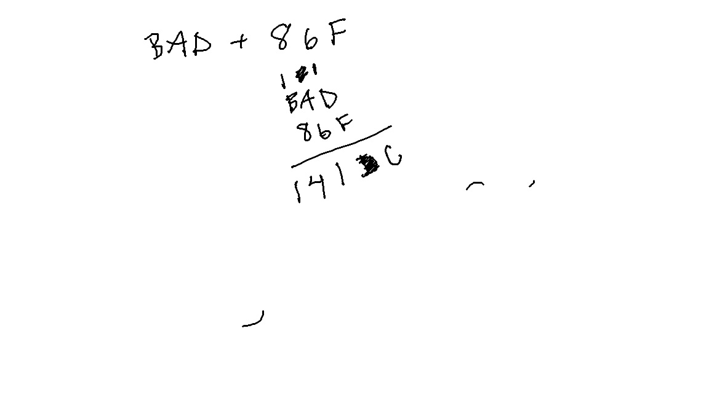
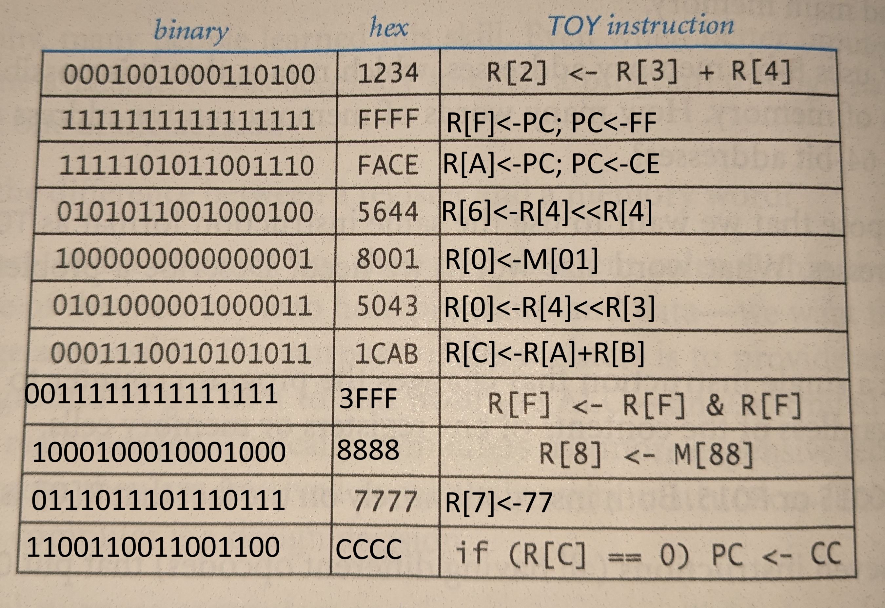

# 1 
# 2 What are some modern examples of programs being treated as data? (Describe at least 3.)
    any aplication while it is being installed or downloaded
    compiliers
    cloud computing
# 3 